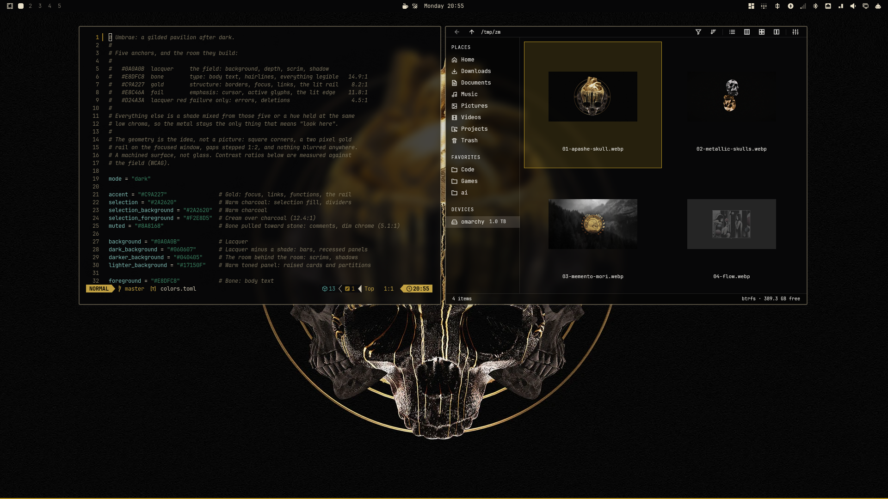
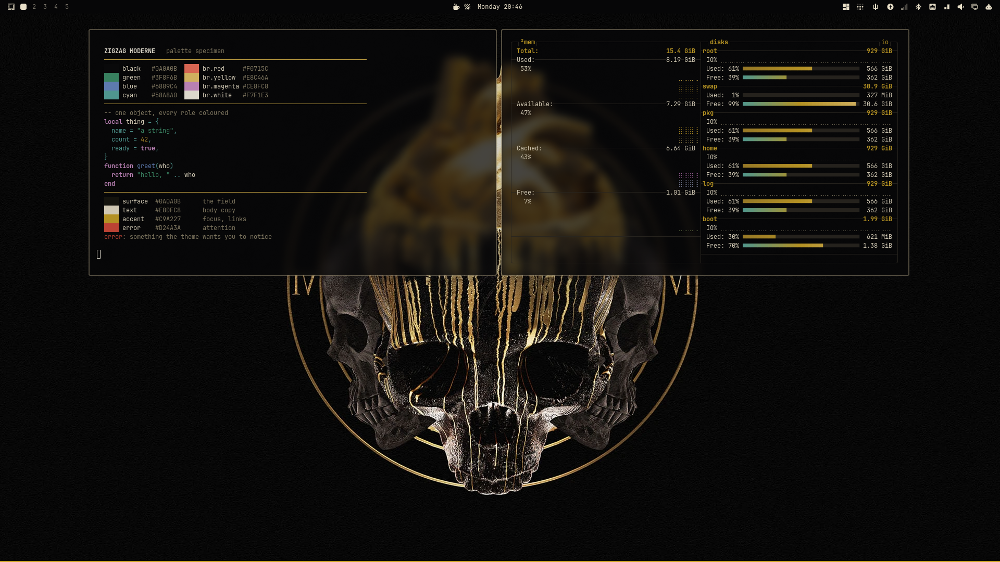
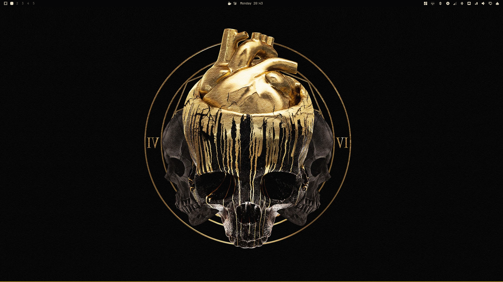

# Zigzag Moderne

An Omarchy theme built the way the style was built: black lacquer, gold
linework, and geometry doing all the work. Square corners, a two pixel rail of
foil over brass around the focused window, gaps stepped 1:2, and no blur
anywhere (with Omarchy's Glassy toggle off — see the caveat below). The desktop
should read as a machined surface, a gilt pavilion after dark rather than glass.

It ships four wallpapers, all of them metal on black, one of them the default.
The geometry lives in the config, so the theme stands on its own whatever is
behind it, and your own wallpapers for it live outside the theme entirely.





---

## Apply

```bash
omarchy theme install https://github.com/Binz120/omarchy-zigzag-moderne-theme
omarchy theme set "Zigzag Moderne"
```

`omarchy theme install` strips the leading `omarchy-` and the trailing `-theme`
from the repository name, so the theme arrives as `zigzag-moderne` and lists as
Zigzag Moderne. A repository install drops `hyprland.lua` and the terminal
configs; see
[Where the geometry actually comes from](#where-the-geometry-actually-comes-from).
The work tree that produced this repository keeps `hyprland.lua` locally, which
is where the full geometry lives.

Its own wallpapers come with it. To use one of yours instead:

```bash
omarchy theme bg install          # opens ~/.config/omarchy/backgrounds/zigzag-moderne/
omarchy theme bg next             # cycle them
```

That directory is outside the theme, so your wallpapers never ship with it.

---

## Palette

Five anchors; everything else is a shade mixed from them, or a hue held at the
same low chroma. Ratios are measured against the field.

| Colour      | Hex       | Role                                                          |
|-------------|-----------|---------------------------------------------------------------|
| Lacquer     | `#0A0A0B` | The field: background, depth, scrim, shadow                    |
| Bone        | `#E8DFC8` | Type: body text, hairlines, everything legible (14.9:1)        |
| Gold        | `#C9A227` | Structure: borders, focus, links, the lit rail (8.2:1)         |
| Foil        | `#E8C46A` | Emphasis: cursor, active glyphs, the lit edge (11.8:1)         |
| Lacquer red | `#D24A3A` | Failure only: errors, deletions (4.5:1)                        |

Support hues stay metals and stone: patinated brass for numbers, verdigris for
success, patina for parameters, midnight blue for functions, plum for keywords.
`brown` is antique brass, and `dark_foreground` is the one value below 4.5:1,
decorative only and never body text.

**The one lit colour rule.** Gold means attention and nothing else. Verdigris
appears only in the terminal palette, because `green` must mean success there;
it does not appear in `shell.toml` or `btop.theme`, because neither has a
success state.

---

## The geometry

- **Corners.** `rounding = 2` with `rounding_power = 1.0`: square, with just
  enough radius to kill the aliased corner.
- **The rail.** `border_size = 2`, gold falling to brass along the focused edge
  (`0deg`, so it is a horizontal rail). Unfocused windows get a muted stone
  hairline.
- **The step.** `gaps_in = 6`, `gaps_out = 12`. The 1:2 ratio is deliberate; the
  rhythm is the ornament.
- **No glass.** With the Glassy toggle off, blur is off and windows sit at 1.0
  and 0.97 opacity. Shell
  surfaces sit between 0.96 and 0.98, separated by value and a one pixel hairline
  rather than by translucency. A flat lacquer surface, not a pane of glass.

  Measured caveat: Omarchy's *Glassy* profile
  (`state/omarchy/toggles/hypr/bar-glassy.lua`) is loaded **after** theme files
  and turns blur back on, so with Glassy enabled you get `blur:enabled = true`,
  `size 4` and `passes 2` regardless of what the theme asks for. The shell still
  reads flat because it sits at 0.96 or above, but Glassy also sets terminal
  alpha to 0.65 and empties btop's `main_bg`, so the machined surface is only
  true with the Glassy toggle off.
- **Mechanical motion.** One near linear curve, no overshoot, `popin 100%` on
  windows, `slide` rather than `slidefade` on workspaces. A switch throws; it
  does not bloom.

### Where the geometry actually comes from

The rail travels in `colors.toml` as `hyprland_active_border`, so it applies on
any install. The rest of the geometry lives in `hyprland.lua`, and Omarchy does
not carry a theme's Lua when that theme was installed from a repository clone;
staging regenerates the compositor layer from `colors.toml` instead. So a plain
`omarchy theme install` of this theme gives you the palette, the shell and the
rail, but Omarchy's own corners, gaps and motion.

To get the whole surface, append this to `~/.config/hypr/hyprland.lua`, after the
`require("default.hypr.toggles")` line. Theme files and `looknfeel.lua` load
before the toggles, so a Glassy toggle would re-enable blur over a block placed
there:

```lua
hl.config({
  general = {
    gaps_in = 6,       -- half the outer gap: the step is the ornament
    gaps_out = 12,
    border_size = 2,
  },
  decoration = {
    rounding = 2,
    rounding_power = 1.0,
    active_opacity = 1.0,
    inactive_opacity = 0.97,
    dim_inactive = true,
    dim_strength = 0.08,
    blur = { enabled = false },
  },
  misc = { background_color = "rgb(0a0a0b)" },
})
```

---

## File map

| Path | Purpose |
|---|---|
| `colors.toml` | The palette. Feeds terminals, editors, btop, the shell and the templates. |
| `shell.toml` | Bar, menus, launcher, notifications, polkit, lock, image picker. |
| `hyprland.lua` | Local only (gitignored): corners, gaps, motion, no-blur. |
| `gtk.css` | GTK 3 and GTK 4: flat lacquer, gold hairlines, square corners. |
| `btop.theme` | Charcoal boxes, gold throughput, brass and foil for heat; no verdigris. |
| `icons.theme` | `Yaru-olive-dark`. |
| `backgrounds/` | Four 16:9 stills. `01` is the default; see [Wallpapers](#wallpapers). |
| `preview.webp` | The main shot: an editor on `colors.toml` beside a file manager on the theme's own wallpapers. |
| `preview-terminal.webp` | The palette specimen, with an ANSI ramp, a syntax sample and a legend, beside btop's memory view. |
| `preview-wallpaper.webp` | The clean desktop: wallpaper and bar, nothing open. |

Terminals, editors and most other apps are rendered from `colors.toml` by
Omarchy, so no terminal configs ship here. There is no `unlock.png` and no
Plymouth wordmark.

No stock files are touched: everything lives in
`~/.config/omarchy/themes/zigzag-moderne/`.

---

## Wallpapers

Four 16:9 stills. The numeric prefix decides the default: `01` sorts first, so a
fresh install lands on it, and `omarchy theme bg next` cycles through the rest.

| File | Resolution | Artwork | Source |
|---|---|---|---|
| `backgrounds/01-apashe-skull.webp` | 1920x1080 | Skull and bones in gold, Roman numerals IV and VI, black ground | [wallhaven `p26jl3`](https://wallhaven.cc/w/p26jl3), uploader ILastKingI |
| `backgrounds/02-metallic-skulls.webp` | 1920x1080 | Silver and gold skulls in relief that reads as liquid metal | unrecorded |
| `backgrounds/03-memento-mori.webp` | 2560x1440 | Gold memento mori medallion with a skull, an hourglass and a candle, over fog and conifers | unrecorded |
| `backgrounds/04-flow.webp` | 3840x2160 | Two figures veined in gold, flanking a sphere, with "FLOW." beneath | unrecorded |

Each is at its own native resolution, nothing here is upscaled, converted to
WebP at quality 90. Only the first has a documented source; if that matters for
where this theme is published, the other three are its open question.

---

## License

MIT, see [`LICENSE`](LICENSE), covers the theme files: the palette, the configs,
the GTK sheet and this README. The wallpapers are third party artwork and remain
their authors'; they are not covered by that licence, and whether they can be
redistributed is their authors' call, not this theme's.
